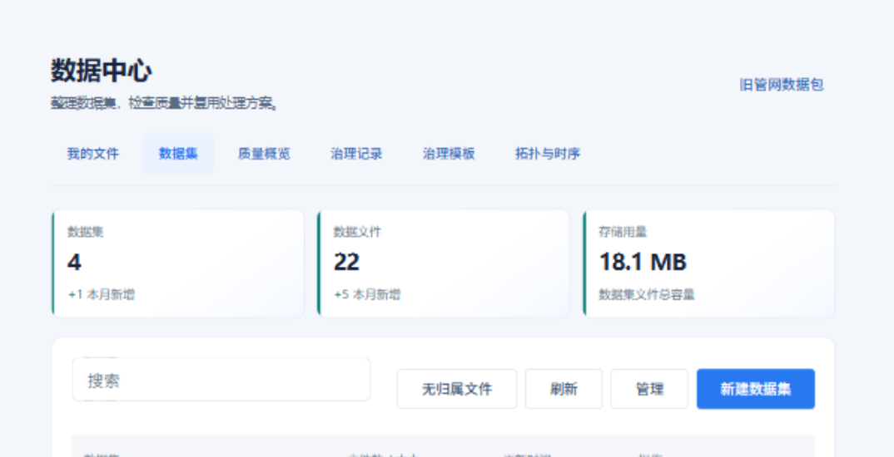

# 数据集与文件管理

## 用途

数据集用于集中管理一组相关资料。同一数据集可以包含不同格式的文件，便于后续查找和分析使用。

## 前置条件与角色

登录后进入【数据中心】，默认显示数据集列表，不需要切换顶部页签。创建、上传和管理操作由当前账户权限决定。尚未加入数据集的文件可从【无归属文件】入口查找。

## 操作步骤

1. 点击搜索栏右侧的【新建数据集】，填写名称和说明后创建。也可在此点击【上传数据】并选择保存位置。
2. 点击目标数据集名称查看文件。进入数据集后，搜索栏右侧的【上传数据】使用当前数据集作为目标；点击【返回】回到目录。
3. 点击文件名称或【预览】，查看列名和样本。若文件仍在解析，待状态更新后再继续；若显示【仅存储】或【解析失败】，点击状态查看原因和建议。
4. 在分析流程中选择已有数据时，打开对应数据集并选取所需文件；也可从项目右侧资料目录添加到画布。
5. 进入数据准备窗口，选择表格或时序读取方式，核对时间列、数值列等设置，再应用到输入节点。
6. 文件更新后，按本次分析需要选择版本。已完成分析的记录继续保留原来使用的数据。

## 结果与失败处理

上传或解析失败时，核对文件格式与内容，并按页面提示处理。上传结果不确定时，先刷新列表确认文件是否已经保存，避免重复上传。

数据集用于组织资料；将文件用于流程后，仍需确认各输入的用途和列设置。文件整理、状态说明和恢复操作参见[数据中心](data-file-explorer.md)。
