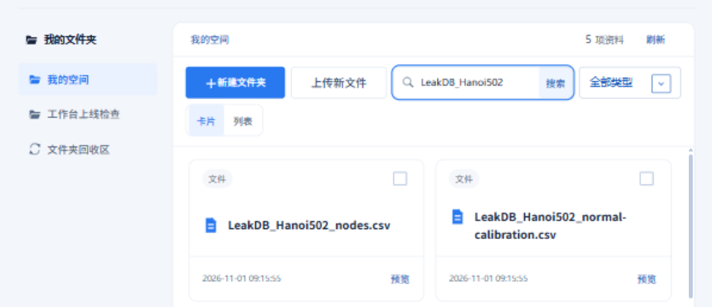

# 我的文件与个人文件夹

## 用途

在【数据中心】的【我的文件】中整理个人文件、数据集和项目。左侧选择文件夹，中间浏览资料，右侧查看详情和文件预览。

## 前置条件与角色

登录后使用个人空间。页面显示当前账户可读取的资料，并按权限提供上传和整理操作。

## 操作步骤

1. 打开【数据中心】，进入【我的文件】。点击左侧文件夹或中间目录，使用路径栏返回上一级。
2. 点击【新建文件夹】并填写名称。需要整理时，选中资料，点击【移动到…】选择目标文件夹；文件夹菜单也可用于重命名和移动。
3. 上传文件后等待解析完成，再选中文件查看预览。上传后未出现在目标文件夹时，先到个人根目录查找。
4. 在【搜索当前文件夹】中输入名称查找资料；搜索范围为当前文件夹。
5. 在项目工作台右侧资料目录中，可将文件拖入画布，或使用添加入口。打开数据准备窗口后，核对列映射并选择预处理方案，再将输入及处理节点加入流程。
6. 仅需读取文件时选择“仅输入”；需要检查或整理时启用相应步骤。确认加入后，可继续修改生成的节点和区域。

## 结果与失败处理

整理文件夹不会修改文件内容和已保存的分析结果。移动失败时刷新目录，确认目标位置后重试。文件解析中或预览失败时，检查文件状态并刷新。

回收文件夹前需先移出其中的资料和子文件夹。已回收的文件夹可在【文件夹回收区】恢复。
