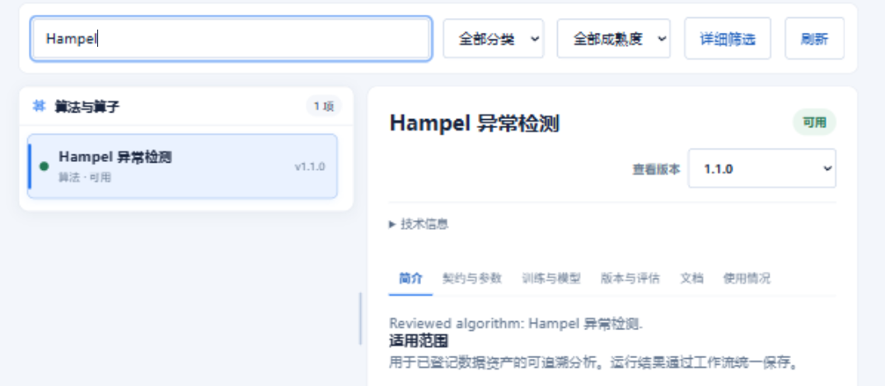

# 算法中心

## 用途

查找算法与算子，了解输入要求、可调整参数、输出内容和版本，为流程选择合适的处理节点。

## 前置条件与角色

从左侧【算法中心】进入。目录中显示当前账户可访问的内容；训练、参数管理等操作按权限开放。

## 操作步骤

1. 输入算法名称、编码或自定义标签关键词搜索；自定义标签按目录默认版本匹配，输入标签名称的一部分也可检索。按分类筛选数据输入、转换、算法或输出等节点，需要进一步缩小范围时打开【更多筛选】。
   在【算法与算子】标题下可切换【全部】【我的上传】【他人上传】；【他人上传】只显示已审核公开且当前账户可用的条目。来源筛选可以和关键词、分类一起使用。
   自己创建的算法项目与其他算法使用相同的列表样式。圆点用灰色、红色和绿色分别表示未完成、不可用和正常。
2. 在列表中选中一项，先阅读算法名称下方的简介，了解用途和适用数据。
3. 打开【详情】中的【契约与参数】，检查输入输出和参数要求，确认能够与本次流程的数据连接。
4. 需要训练或管理模型时，直接打开主页面签【训练与模型】。算法的使用情况可在【详情】中的【使用情况】查看。
5. 在【详情】中的【版本与评估】查看可访问版本及其状态。确定使用后，在项目的节点目录中添加对应节点。
6. 如需建立新流程，进入【流程中心】点击【新建流程】，在画布中继续组织数据输入、处理和结果输出。

在【详情】的【基本信息】中可查看名称、简介和成熟度。上传者可编辑自己的算法版本；平台内置条目由算子管理员维护。成熟度可设为「开发中」或「可用」，不可运行的版本只能设为「开发中」。编辑基本信息不会改变安装、运行或审核状态。

## 本次试用与历史记录

### 使用 INP 划分候选分区

当算法中心可见【管网 DMA 候选分区】1.0.0 时，可以在流程中使用自己的 EPANET INP 文件，不需要另做一份 CSV。

1. 将 INP 文件上传到数据中心，等待解析完成。先预览节点和管段，核对它们与原文件一致。缺坐标不妨碍计算；预览标明的自动布局不是实际地理位置。
2. 在流程中添加【数据文件输入】1.1.0，选中这份 INP 的确切版本，点【使用此管网】。旧输入节点仍按原版本运行；要在新草稿中绑定 INP，请添加 1.1.0 版输入节点。
3. 添加【管网 DMA 候选分区】，把【数据文件输入】的【管网拓扑】输出连接到算法同名输入。目标分区数默认 0（自动）；需要比较不同分区数时，可指定 1–64 内的可行值。
4. 运行完成后先看着色管网图；需要逐项核对时再展开明细，查看节点归属和跨区边界。缺少坐标时可查表，不把推测的位置当作原始坐标。同一算法版本、同一输入版本及参数可复现候选结果。

算法按文件中的初始通断状态计算，不做水力仿真，也不更改原 INP。所得边界是分析候选，不是已通过校核的现场关阀方案。若编号重复、端点无效或请求的分区数对该网络不可行，请检查原文件或调整分区数。数据中心对 INP 的检查不会替用户修复管网。

### 查看试用记录

选中算法和版本后，打开【试用】页签选择数据并配置参数。运行后的结果显示在同页的【本次试用结果】，可点击【打开结果记录】查看这次运行的详情。

点击【试用记录】打开【我的试用记录】窗口。列表包含个人各算法的快速试用记录，不限于当前选中的算法；核对列表中的时间和状态，使用【上一页】【下一页】翻页查找。选择一条记录后，在右侧查看结果，展开【本次参数】核对当时的设置；有多个结果时可切换查看。

关闭窗口后仍留在原来的算法页面。查看、刷新记录不会重新执行算法；记录读取失败时可重试，运行尚未完成时可稍后点击【刷新记录】。

## 结果与失败处理

管理员可在选中算法版本后点击【编辑标签】，多选业务领域和任务类型。保存后，目录按新标签筛选该算法的默认版本；如正在查看的是其他版本，目录仍以默认版本为准。点击【恢复原始标签】可撤销管理员的覆盖设置。

### 导入新算法

有导入权限时，点击搜索栏右侧的【＋】进入【新建算法】，填写算法名称和描述。业务领域、任务类型、自定义标签和算法包均可稍后添加。创建成功后，列表选中新项目，右侧打开该项目；点击【编辑信息】修改资料，或选择算法包。没有文件的项目仅自己可见，不参与试用、审核或流程执行。

选择文件后，后台自动检查算法包。包内声明一项算法时，填写的信息自动关联到该算法，即使包内还附带节点；只含一项独立节点的包也可导入。包含多项算法，或没有算法但包含多项独立节点时，请拆成单算法包，或到【资源广场】使用高级导入。首次新建即使已选 ZIP，也只点击【创建项目】；已建项目则在右栏选好文件后点击【上传】。

关联条目这一版本的业务领域、任务类型和自定义标签以表单填写的内容为准；全部留空时，不沿用包内 YAML 中的这些标签。自定义标签仅属于该算法版本，不会加入平台公共标签选项。标签设置不改变算法包的技术校验要求。

文件已准备好时，可选择 schema 2.0 格式的 ZIP 算法包并直接上传。上传前可修改信息或更换文件，填写内容用于算法中心展示，不修改包内源码或版本。

1. 上传后在右栏点击【验证并安装】，等待服务端完成。离开再打开同一项目可查看进度。验证失败时按提示处理，不覆盖原来可用的版本。
2. 项目可用后可以试用或在流程中使用。在项目管理区域可查看版本、申请公开或撤回待审申请。审核通过且满足运行条件的版本对有权限的账户开放；账户已经明确停用的内容不会被自动重新启用。
3. 管理员从独立的【算法审核】菜单进入，在【待审核】中选择申请，核对展示名称、简介和标签，再点击【通过】或【退回】。退回时需填写简短原因并确认，提交者随后可查看。

可在【新建算法】的【开发资料】中直接下载【算法模板】【开发 SDK】【开发说明】；【资源广场】的【导入扩展】中也保留这三个下载入口。算法代码在本地开发、修改和打包。回到同一项目点击【上传新版本】，用【管理版本】选择要查看的版本；展示信息编辑不提供在线代码修改。

导入内容可通过【在流程中使用】进入流程编排，在节点目录中添加对应节点并连接数据。此操作使用已有工作流执行能力；单算法试用仅在页面提供对应试用入口时使用。

当前界面不再显示旧的源码预览和行级批注入口，已有源码与批注记录未删除。审核决定与退回原因在上述审核流程中查看。

点击左下角的窗口条可恢复最小化的新建窗口，未上传的文件和预检结果会保留。关闭会清除未提交的选择，不会删除已上传的版本或取消已受理的任务。

要删除自己建错的项目，打开右栏【更多操作 → 删除项目】，核对名称后确认。删除针对整个项目，不只是选择的版本；不能在此自行恢复。空项目或满足删除条件的私有项目可以移除；公开、待审、任务进行中、被引用或已有业务使用历史的项目不能直接删除。遇到阻止提示时，请先核对原因，不要删除既有运行记录来解除限制。

未找到内容时，清空部分筛选并刷新目录。版本不可用或环境尚未准备完成时，先查看提示，再联系管理员处理。

修改默认参数前应确认操作范围；项目中已经填写的参数仍需在节点属性中核对。具体模型操作参见[训练与模型工作台](training-model-workbench.md)。
