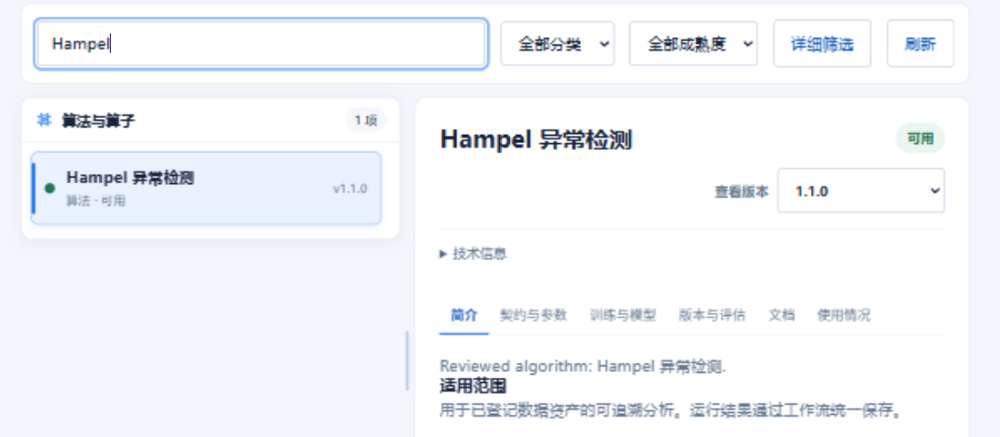

# 算法中心

## 用途

查找算法与算子，了解输入要求、可调整参数、输出内容和版本，为流程选择合适的处理节点。

## 前置条件与角色

从左侧【算法中心】进入。目录中显示当前账户可访问的内容；训练、参数管理等操作按权限开放。

## 操作步骤

1. 输入名称或关键词搜索，按分类筛选数据输入、转换、算法或输出等节点。需要进一步缩小范围时打开【详细筛选】。
2. 在列表中选中一项，先阅读【简介】，了解用途和适用数据。
3. 打开【契约与参数】，检查输入输出和参数要求，确认能够与本次流程的数据连接。
4. 需要训练或管理模型时，直接打开主页面签【训练与模型】。算法的使用情况可在【详情】中的【使用情况】查看。
5. 在【版本与评估】中查看可访问版本及其状态。确定使用后，在项目的节点目录中添加对应节点。
6. 如需建立新流程，可点击【新建流程】，在画布中继续组织数据输入、处理和结果输出。

## 结果与失败处理

管理员可在选中算法版本后点击【编辑标签】，多选业务领域和任务类型。保存后，目录按新标签筛选该算法的默认版本；如正在查看的是其他版本，目录仍以默认版本为准。点击【恢复原始标签】可撤销管理员的覆盖设置。

### 导入新算法

有导入权限时，点击搜索栏右侧的【＋】打开【算法导入与审核】。在【上传新包】选择含算法或节点的 ZIP；预检通过后可补充目录标签，再确认上传。

1. 上传受理后会自动打开【我的导入】中的该版本。按页面给出的操作完成环境准备、试运行、安装和启用；不需要代码环境的包可直接进入适用步骤。
2. 安装后可在【公开审核】中提交申请或撤回待审申请。退回的版本可查看审核意见。
3. 管理员可从【待审核】选择一个申请，核对内容、依赖和验证记录，然后批准公开或填写原因并退回。

上传区提供【算法模板】【开发 SDK】【开发说明】。审核时打开【源码与批注】，按目录选择文件，点击行号或按住 Shift 选择连续行，再添加批注。批注随批准或退回决定保存，不修改源码。提交者可在【我的导入】打开退回版本，点击批注中的文件和行号定位。

点击左下角的窗口条可恢复最小化的窗口，所选文件、预检结果和当前审核记录会保留。关闭会清除未提交的选择，不会删除已上传的版本或取消已受理的任务。

未找到内容时，清空部分筛选并刷新目录。版本不可用或环境尚未准备完成时，先查看提示，再联系管理员处理。

修改默认参数前应确认操作范围；项目中已经填写的参数仍需在节点属性中核对。具体模型操作参见[训练与模型工作台](training-model-workbench.md)。
