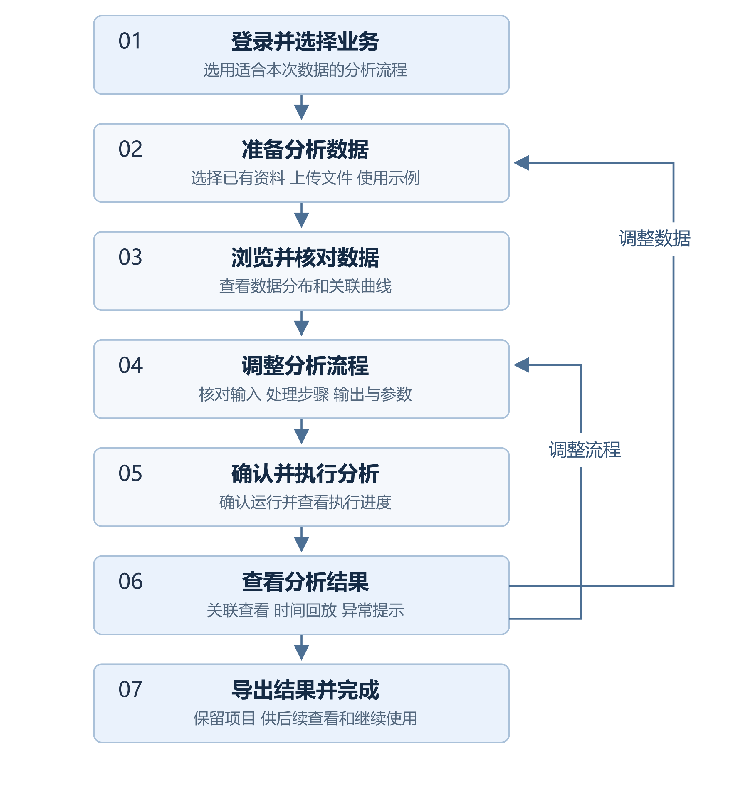

# 使用项目工作台

## 用途

项目工作台用于完成一次分析。数据准备、流程调整、执行进度和结果查看都围绕当前项目展开；完成后可从流程中心重新打开项目。

## 进入工作台

登录后点击左侧【开启新任务】。选择业务任务，或在【描述目标】中输入分析目标，再从页面列出的可用流程中选择方案。已有项目可从【最近项目】或【流程中心】打开。

## 操作步骤

1. 选择分析流程后，在下方准备资料。可以选择已有数据、上传新文件，或使用页面提供的演示资料。
2. 核对资料准备状态。页面询问字段或时间列时，按提示选择。准备完成后进入项目。
3. 提供数据浏览阶段的项目，可先查看数据分布、点位和关联曲线，再点击【进入流程编排】；其他项目直接打开编排画布。
4. 检查数据输入、处理步骤、连接和参数。点击【开始分析】，按提示补全配置，再在确认窗口核对项目与输入并提交。
5. 提交成功后，工作台显示运行进度，并逐步呈现已生成结果。分析完成后查看图表、报告及相关数据，按需导出。
6. 需要修改时使用【调整数据】或【调整流程】返回编辑。已有分析可通过【返回分析工作台】继续查看；调整完成后再次确认运行，生成新一轮结果。

## L-Town 四步演示

使用 L-Town 资料时，可沿【资料整理】【DMA 初划】【爆管风险筛查】【监测补点】逐步查看结果。此演示使用资料中的管网连接关系和历史观测，不运行水力模拟；压力突降是待复核线索，补点是踏勘候选，均需结合实际情况判断。

1. 在【数据体检】核对缺失值、完全重复行和不规则间隔。点击【查看位置】可查看原始资料中前 20 条对应问题记录，按测点、时间和采样序号核对。检查不会自动清洗；在【建议处理方案】中选择是否清除完全重复记录，按需勾选【用相邻观测均值补齐孤立缺值】，再点击【确认处理方案】，也可保留原始资料。没有需要处理的重复记录或孤立缺值时，点击【继续分析】或对话区的【确认检查结果】继续。其余缺值和同刻冲突记录留待复核。
2. 点击【开始 DMA 初划】，查看各区节点数、监测点数和实测压力范围，展开【查看分区依据】核对划区依据。选择【采用当前分区】或【按全网汇总】后继续。
3. 点击【筛查爆管风险】，查看待复核测点、发生时间、压力下降量和邻接管段。点击结果可定位测点与观测曲线；在【筛查灵敏度】中选择【较灵敏】【标准筛查】或【严格筛查】，比较候选变化。
4. 点击【分析监测覆盖】，查看优先踏勘点。在【每区候选数量】中选择每区最多 1、2 或 3 个候选，逐个查看其与已有压力测点的连接距离。候选不足时，显示实际可推荐的数量。

各阶段产生结果后，可从对话区【本次分析】中的【资料检查】【分区方案】【风险筛查】【监测补点】回看已有结果，不必重新开始。查看分区、风险或补点结果时，用【分析区域】切换全网或已采用的分区，让列表与地图聚焦同一范围。也可继续输入修改意见，如“只去重，缺值保留”“查看第一区”或“多给几个备选点”，再核对右侧设置和结果。

实际去重或补值后，可点击【下载整理后的监测记录】保存 CSV；未改动记录时不提供此下载入口。整理和下载针对浏览器中的本次分析副本，原始资料不变，也不会自动在数据中心创建或更新文件。

## 使用语音输入

语音功能开放后，首页、右下角的【诺亚】和 L-Town 示例对话的输入框旁各有一个录音键。需要先登录，并通过 HTTPS 或 localhost 本机安全入口访问；浏览器须支持麦克风录音，当前入口也须获平台允许。普通远程 HTTP 不能使用此功能。

1. 点击【开始录音】后，浏览器才会申请麦克风权限；按提示允许访问。未点击录音键时不会开启麦克风。
2. 说话时，识别文字会逐步回填到草稿，后续识别可能修订前面的转写。连接、录音和收尾期间，输入框暂不可手动编辑。
3. 说完静音约 1.3 秒会自动结束，也可点击同一个录音键【停止录音】。等待【正在收尾】结束后，输入框恢复编辑。
4. 核对名称、编号和数值，必要时修改，再点击【发送】。转写只填写草稿，不会自动发送或执行分析。

离开当前输入页面或关闭对话窗口会结束麦克风使用。若希望保留完整转写，先停止录音并等待收尾，再离开。

录音键未显示时，先检查登录状态、安全入口和浏览器支持。语音服务启动后可能仍需准备；遇到【语音暂不可用，请重试。】或连接超时，可稍后重试，期间继续键入文字。提示【未获得麦克风权限。】时，在浏览器中检查该站点的麦克风权限；提示未找到麦克风时，检查设备连接。录音或转写中断后，先核对已回填的草稿再继续，文字输入不依赖语音服务。

## 常见问题

- **资料还未就绪**：刷新资料状态，检查解析结果和输入配置后继续。
- **创建结果不确定**：先到流程中心核对是否已经生成项目，避免重复创建。
- **无法保存或运行**：按页面提示检查缺失的数据、参数或连接；无操作权限时联系管理员。
- **结果与当前配置不同**：先确认所选分析记录；修改流程后，需要重新运行才能查看新配置的结果。
