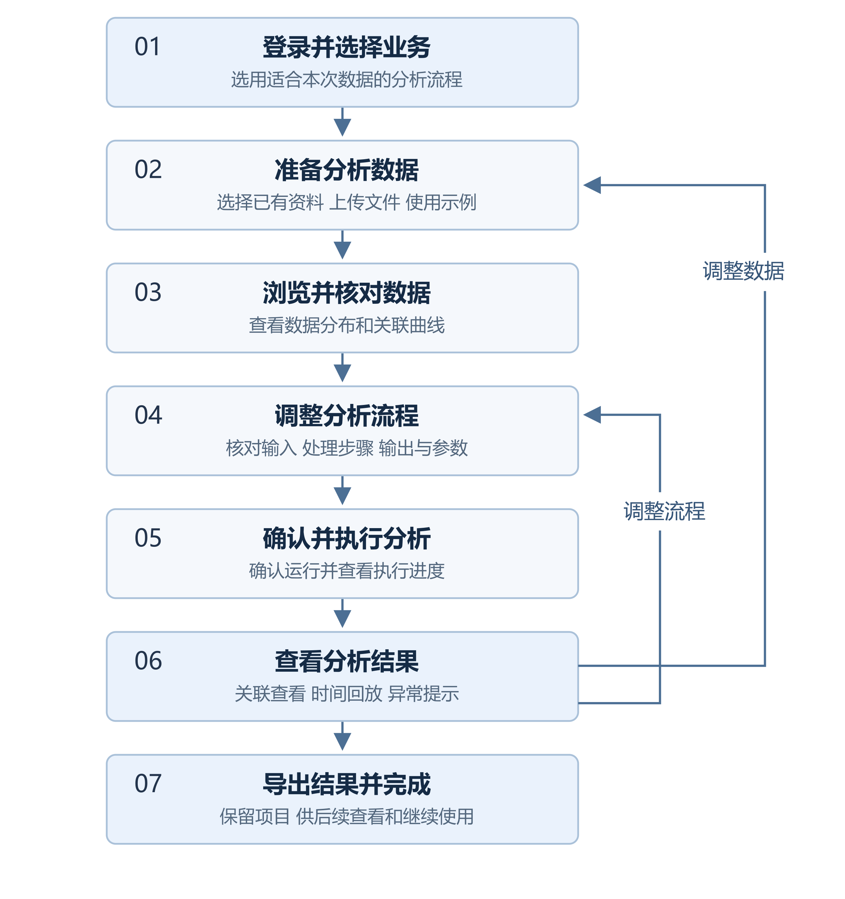
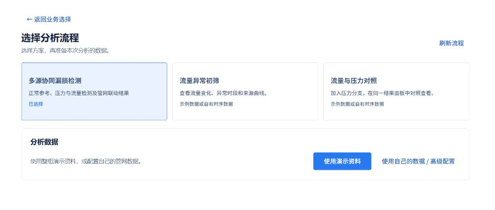

# 使用项目工作台

## 用途

项目工作台用于完成一次分析。数据准备、流程调整、执行进度和结果查看都围绕当前项目展开；完成后可从流程中心重新打开项目。

## 进入工作台

登录后点击左侧【开启新任务】。选择业务任务，或在【描述目标】中输入分析目标，再从页面列出的可用流程中选择方案。已有项目可从【最近项目】或【流程中心】打开。

## 操作步骤

1. 选择分析流程后，在下方准备资料。可以选择已有数据、上传新文件，或使用页面提供的演示资料。
2. 核对资料准备状态。页面询问字段或时间列时，按提示选择。准备完成后进入项目。
3. 提供数据浏览阶段的项目，可先查看数据分布、点位和关联曲线，再点击【进入流程编排】；其他项目直接打开编排画布。
4. 检查数据输入、处理步骤、连接和参数。点击【开始分析】，按提示补全配置，再在确认窗口核对项目与输入并提交。
5. 提交成功后，工作台显示运行进度，并逐步呈现已生成结果。分析完成后查看图表、报告及相关数据，按需导出。
6. 需要修改时使用【调整数据】或【调整流程】返回编辑。已有分析可通过【返回分析工作台】继续查看；调整完成后再次确认运行，生成新一轮结果。

## 常见问题

- **资料还未就绪**：刷新资料状态，检查解析结果和输入配置后继续。
- **创建结果不确定**：先到流程中心核对是否已经生成项目，避免重复创建。
- **无法保存或运行**：按页面提示检查缺失的数据、参数或连接；无操作权限时联系管理员。
- **结果与当前配置不同**：先确认所选分析记录；修改流程后，需要重新运行才能查看新配置的结果。
