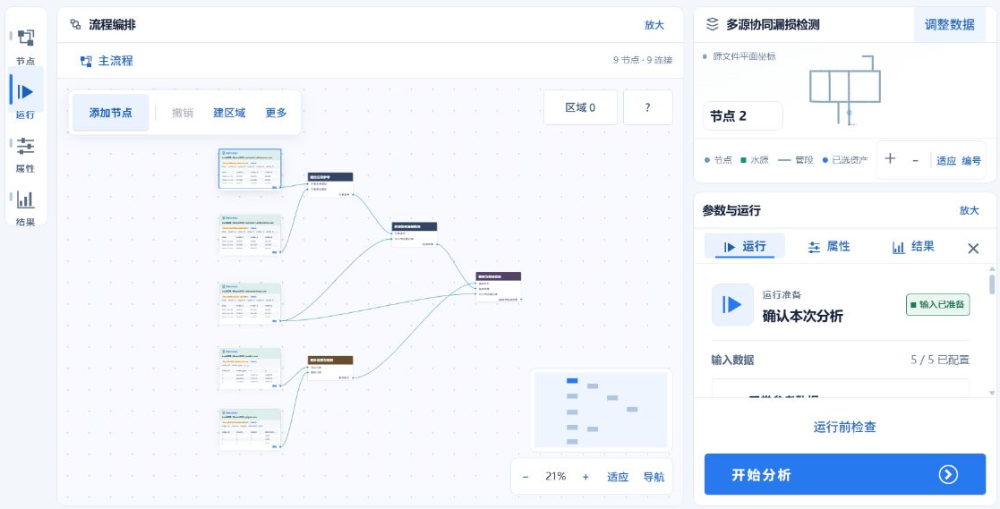

# 编排和调整分析流程

## 用途

编排画布把数据输入、处理步骤和结果输出连接为分析流程。可以从现成方案开始调整，也可以在空白画布中添加节点。

## 进入编辑器

从项目工作台点击【进入流程编排】或【调整流程】；也可在流程中心打开项目草稿。没有编辑权限时，可查看流程和参数。

## 操作步骤

1. 点击【添加节点】，搜索所需节点并添加到画布。选择数据输入节点，配置文件和字段；已有资料也可从工作台资料目录拖入画布。
2. 从前一节点的输出连接点拖到后一节点的输入连接点。按数据经过的顺序组织步骤，检查必要输入是否已连接。
3. 点击节点，在【属性】中填写参数或调整数据绑定。切换节点时，右侧显示所选节点的配置。
4. 需要整理画布时，多选相关节点并点击【建区域】，填写名称。完整放入区域的节点会成为成员；拖动区域标题可一起移动，拖动边缘或角上的手柄调整范围。收起区域后，可再展开继续编辑。
5. 使用【撤销】和【重做】恢复编辑步骤。可通过缩放、【适应】和缩略图调整查看位置。
6. 检查保存状态，点击【开始分析】。根据检查清单补全配置，在确认窗口核对本次输入后提交运行。

## 常见问题

连接失败时，检查输入输出类型及连接数量。节点提示版本不可用时，先恢复所需版本或选择可用版本，再检查参数和连线。

提交前发现问题，可返回调整；执行期间修改草稿时，已经提交的运行仍使用原配置。需要继续查看已有分析时，点击【返回分析工作台】。
