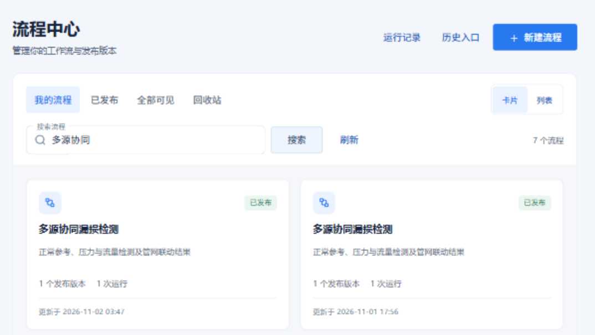

# 查找和管理项目流程

## 用途

流程中心集中展示当前账户可访问的项目。可从这里继续编辑、查看分析记录，或使用已有版本建立新的草稿。

## 进入流程中心

点击左侧【流程中心】。页面提供卡片和列表两种查看方式；选择项目后，在详情区域查看其状态、版本和可用操作。

## 操作步骤

1. 选择流程范围，输入流程名称或自定义标签的部分文字，按回车或点击【搜索】。在搜索栏下点选【业务领域】【流程用途】或已有的【自定义标签】，每组选一项，各组可组合；点击该组【全部】取消此项筛选。点选不会提交搜索框里尚未确认的文字。
2. 选中项目，查看简介、草稿状态及已有版本。点击编辑入口进入项目工作台，继续配置数据和流程。
3. 点击【新建流程】，填写名称，按需选择标签。可在【新标签】输入文字并点【添加】；不填标签也能继续。选择起始模板后，点击【创建草稿并进入编辑器】。
4. 需要基于已有发布内容继续修改时，选择【从最新版本派生】，或在版本列表中选择目标版本并点击【派生草稿】。打开后核对数据和参数，再保存或运行。
5. 不再使用的项目可按页面提供的操作【移入回收站】。需要找回时，在有权限访问的回收站中选择项目并恢复。

## 版本与继续使用

修改已有流程的标签时，在卡片或列表中选中流程，在右侧详情点击【编辑标签】。调整分类或自定义标签后点【保存标签】。每个流程可以有多个标签，自定义标签可用于关键词搜索。不在当前筛选范围内的流程会从列表中消失，不代表被删除。

标签属于流程目录，不是流程状态。改标签不会改编排草稿、生成发布版本或重新执行历史任务。没有编辑权限或流程已在回收站时，不提供编辑入口。

草稿用于编辑，已发布版本用于保留一份确定的流程配置。修改草稿后重新运行，会产生新的分析记录；原记录仍可查看。

从模板建立项目后，应检查输入资料及参数。使用扩展模板时，先确认所需扩展已启用；读取不到模板或缺少数据时，按提示补全。

## 常见问题

列表为空时，先清除搜索条件并检查范围筛选。项目无法打开时，确认是否已经移入回收站或失去访问权限。派生提示冲突时，刷新并核对当前草稿后再操作，避免覆盖其他页面的修改。
