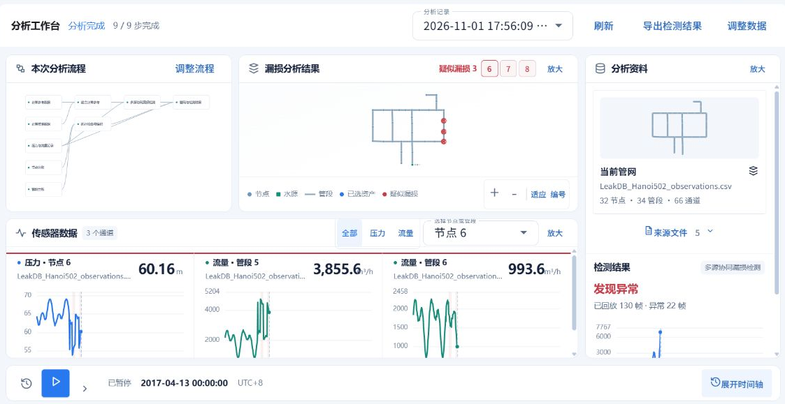

# 查看分析记录和结果

## 用途

分析工作台用于查看一次运行的进度和输出。图表、报告、表格及可下载结果按当前流程组织，分析记录用于回看同一项目此前的运行。

## 打开分析工作台

确认提交分析后，项目自动进入对应的分析工作台。查看已有记录时，打开项目并进入【分析工作台】，再选择需要查看的分析记录。

## 操作步骤

1. 查看总体运行状态和流程进度。运行期间，已生成的结果会陆续显示；等待中的项目会在数据就绪后更新。
2. 展开需要阅读的结果。不同输出会显示为曲线、表格、指标、报告或文件卡片；有多个结果时，按标题选择。
3. 支持时间回放的结果可播放或暂停。展开时间轴后调整查看时刻，曲线、读数与相关标记随时间同步更新。
4. 在支持对象关联的视图中选择点位或管段，下方查看其关联曲线。切换对象后，可继续比较同一时段的数据变化。
5. 使用【分析记录】选择历史运行。需要保留结果时，点击页面提供的导出或下载按钮。
6. 需要修改输入或流程时，点击【调整数据】或【调整流程】。编辑期间仍可返回已有分析；完成调整后，再次确认执行以查看新结果。

## 常见问题

结果读取失败时，可先点击【刷新】重新读取。运行失败时，根据简要提示检查输入、参数和流程配置，修正后重新分析。

查看历史结果时，注意所选记录及分析时间。当前草稿的修改会保留在编辑区，历史结果仍对应原来那次运行。
